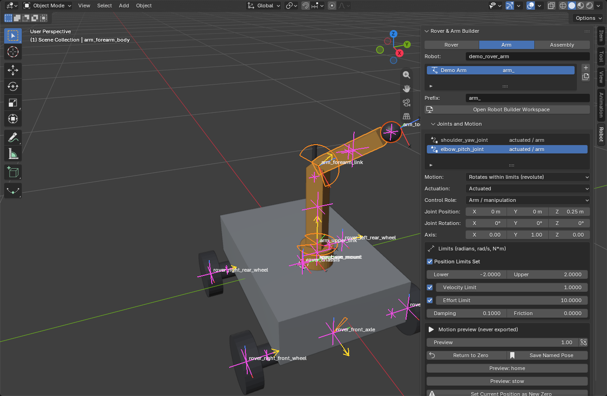
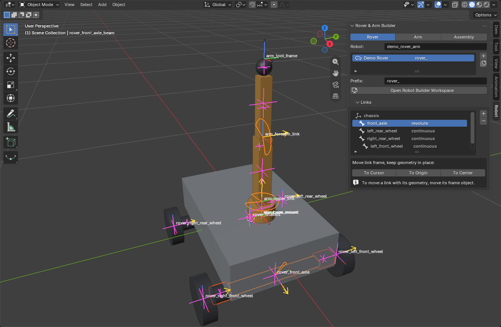
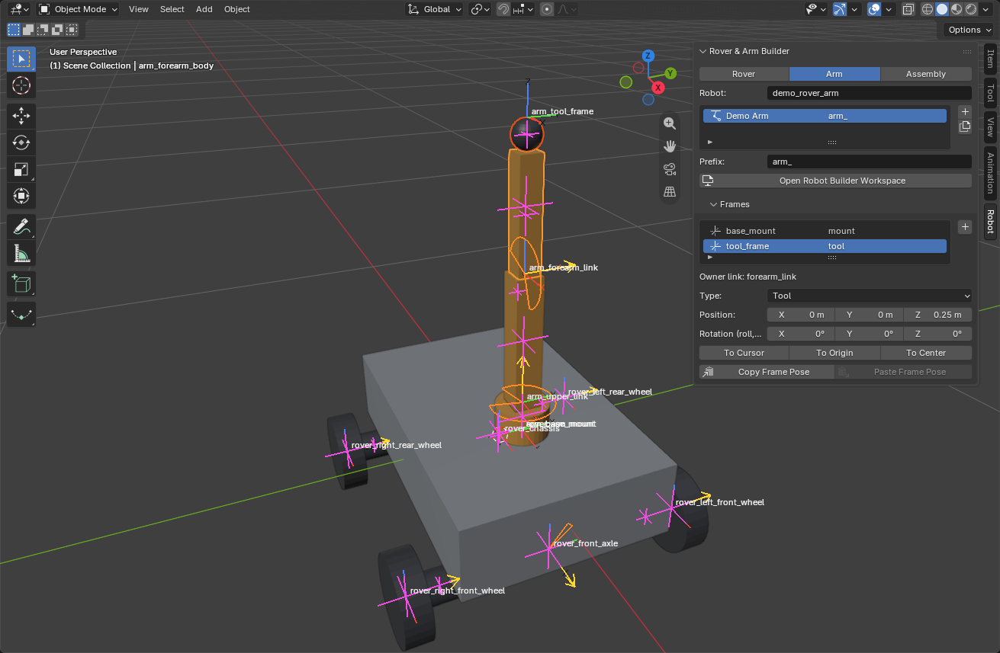
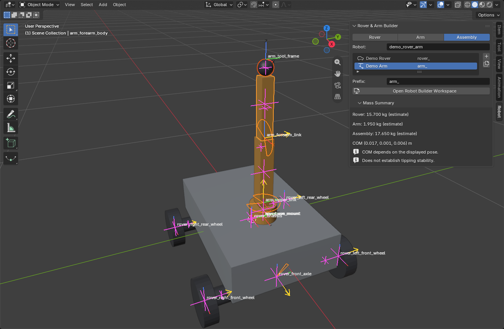
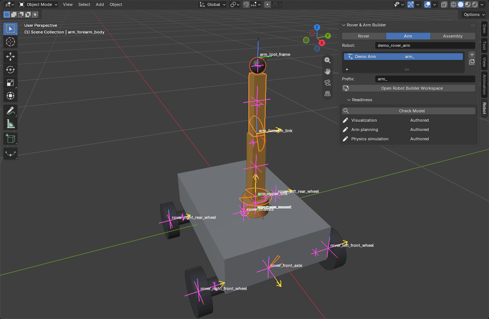
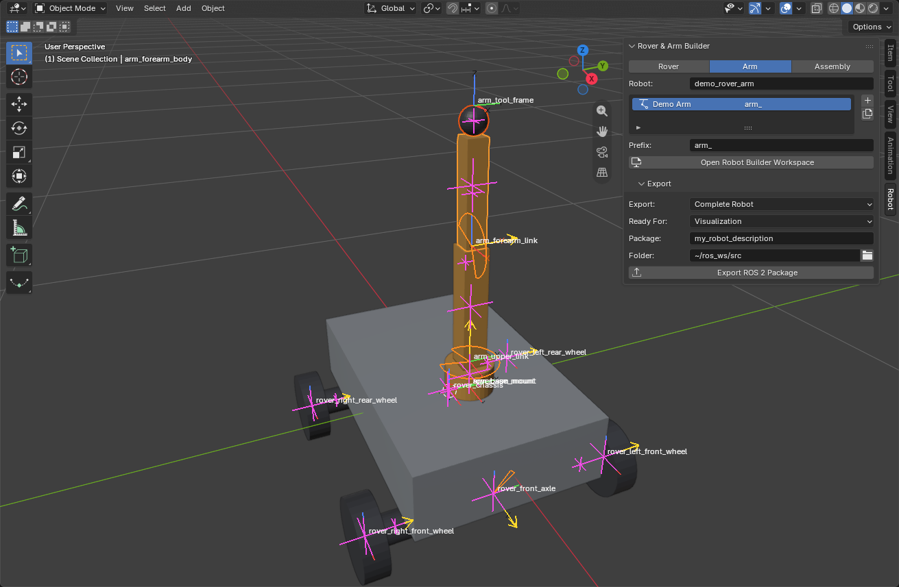

# BILLEE Creation Toolkit

Build a 1:1 model of a rover and arm **inside Blender**, define how every part moves, estimate its mass, and export a
ROS 2 package that runs on the BILLEE software stack.



- **Three workspaces:** Rover, Arm, and Assembly share one robot model.
- **Real engineering data:** joints, limits, frames, mass, center of mass, inertia, and collision shapes.
- **One-click export:** URDF, Xacro, `ros2_control`, Gazebo, and a ready-to-build ROS 2 package.
- **Works offline:** you do not need ROS installed to design or export a robot.

## Contents

- [Install](#install)
- [Build your first robot](#build-your-first-robot)
- [Run it in ROS 2 and Gazebo](#run-it-in-ros-2-and-gazebo)
- [What has been tested](#what-has-been-tested)
- [Development](#development)

## Install

You need [Blender 5.3 or newer](https://www.blender.org/download/) on Linux x64, Windows, or an Apple Silicon Mac.

**[Download the installer](https://github.com/LucaLanzi/BILLEE-creation-toolkit/releases/latest/download/BILLEE-Creation-Toolkit-0.1.0-Installer.zip)**,
unzip it, and run the file for your system:

| System | What to do | If it is blocked |
|---|---|---|
| **Windows** | Double-click `Install-Windows.bat` | Choose **More info**, then **Run anyway** |
| **macOS** | Double-click `Install-macOS.command` | **System Settings > Privacy & Security > Open Anyway** |
| **Linux** | Run `sh Install-Linux.sh` | |

The installer finds Blender, checks its version, installs and enables the extension, and confirms it worked.

**Prefer no script?** Drag `rover_arm_builder-0.1.0.zip` from the unzipped folder into an open Blender window.

**Already have this repo?** On Linux or macOS, run:

```sh
make install
```

### Open the toolkit

In Blender, hover over the 3D Viewport, press **N**, and click the **Robot** tab on the right edge.

<details>
<summary><b>Update, uninstall, and troubleshooting</b></summary>

To update, run the newer installer. To uninstall, run one of these in the unzipped folder:

```sh
Install-Windows.bat uninstall          # Windows
sh Install-macOS.command --uninstall   # macOS
sh Install-Linux.sh --uninstall        # Linux
```

| Problem | Fix |
|---|---|
| Blender is not found | Point to it: `BLENDER=/path/to/blender sh Install-Linux.sh`. On Windows, run `set "BLENDER=C:\path\to\blender.exe"` first |
| "5.3 or newer is required" | Install a current Blender. Older versions can stay installed |
| Several Blender versions | The installer uses the newest. Set `BLENDER` to choose another |
| The Robot tab is missing | Enable **Rover & Arm Builder** in **Edit > Preferences > Add-ons** |

</details>

## Build your first robot

Want to look around first? Press **Create Demo Robot** in the Robot tab. Its dimensions and masses are illustrative
and are not BILLEE's real values.

### 1. Create the rover and its links

Open the **Rover** tab and press **+** beside the module list. A **link** is one rigid body. In **Links**, select a
parent and press **+** to attach a child, then choose how it moves. The list is indented to show the robot's structure.



### 2. Add parts and mass

In **Components and Mass**, press **+** and pick a part type such as Chassis, Wheel, or Motor Housing. Type dimensions
in any unit, for example `100mm`. Then choose where the mass comes from: measured, estimated, density, or manual.

> Put each motor housing on the link that **carries** it, not on the wheel, so the housing does not spin with the wheel.


### 3. Define joints and preview motion

Open **Joints and Motion** to set the axis, limits, and whether a joint is actuated or passive. Drag **Preview** to see
it move, save poses like `home` and `stow`, then press **Return to Zero**. Preview never changes your exported robot.


### 4. Add mounting and tool frames

In **Frames**, add a `mount` frame on the rover and on the arm, plus a `tool` frame at the arm's tip. Snap a frame to the
3D cursor, an object's origin, or its center, or type its exact position.



### 5. Mount the arm on the rover

Open the **Assembly** tab and choose both modules and both frames. Press **Preview Alignment**, adjust the offset if
needed, then press **Confirm Mount**. You can detach and remount at any time.


### 6. Inspect collision and mass

**Display** switches between visual and collision views and toggles the frame, axis, limit, and center-of-mass guides.
**Mass Summary** adds up the rover, arm, and full assembly.




> The collision overlay is a visual aid and does not test for collisions. A center-of-mass marker does not prove
> the robot will not tip.

### 7. Check the model

Press **Check Model** in **Readiness**. Each problem says what is wrong and how to fix it. Press **Select and Open
Settings** to jump straight to the affected part.


Once the problems are fixed, all three targets show as ready to export:



### 8. Export

In **Export**, choose the complete robot or just the selected module, name the package, pick a folder, and press
**Export ROS 2 Package**.



### Handy tips

- Number fields accept math. Joint limits are in radians, so `radians(45)` works, and `250/1000` enters 250 g as kg.
- To move a link **with** its geometry, move its frame object. To move **only** the frame, use **To Cursor**,
  **To Origin**, or **To Center** in the Links panel.
- Moving the whole robot in Blender does not change the export.

## Run it in ROS 2 and Gazebo

Exports target the BILLEE stack in
[`billee-software-2027`](https://github.com/BILLEE-BroncoSTAR/billee-software-2027): **ROS 2 Humble, Gazebo Fortress,
and `ign_ros2_control`**. From its dev container:

```sh
cp -r my_robot_description ros2_ws/src/
cd ros2_ws
pixi shell
colcon build --packages-select my_robot_description
source install/setup.bash

ros2 launch my_robot_description display.launch.py   # RViz with joint sliders
ros2 launch my_robot_description gazebo.launch.py    # Gazebo with controllers
```

The exported package is separate from the rover's existing `robot_description`, so it does not replace it. Keep your
own files in `config/user/`. If you edit a generated file, the next export stops and names it instead of overwriting it.

## What has been tested

| Area | Status |
|---|---|
| Blender 5.3.0 interface, undo, save and reload, install and uninstall on Linux | **Tested** |
| Real `xacro`, URDF parser, and TF on ROS 2 Humble | **Tested** |
| Gazebo Fortress: spawn, settle, arm control, wheel drive | **Tested** |
| Windows and macOS installers | **Not yet run on those systems** |
| RViz window | **Not yet opened** |
| MoveIt | **Not tested.** It is not in the BILLEE Humble environment, so the generated config is a starting point |

Details are in [docs/TESTING.md](docs/TESTING.md) and known limits are in [docs/LIMITATIONS.md](docs/LIMITATIONS.md).

## Development

Requires Python 3.11+ and Blender 5.3+, with no other dependencies.

```sh
make test     # Fast unit tests, no Blender needed
make check    # Every local check, in an isolated Blender profile
make gui      # Also opens a real Blender window
make ros      # Real ROS 2 Humble and Gazebo checks, using the billee-software-2027 container
make bundle   # Build the installer ZIP for all platforms
make docs     # Recapture the screenshots in this README
```

On Windows, run the same scripts directly, for example `py scripts\check.py`.

See [Architecture](docs/ARCHITECTURE.md) and [Compatibility](docs/COMPATIBILITY.md).

## License

GPL-3.0-or-later. See [LICENSE](LICENSE).
