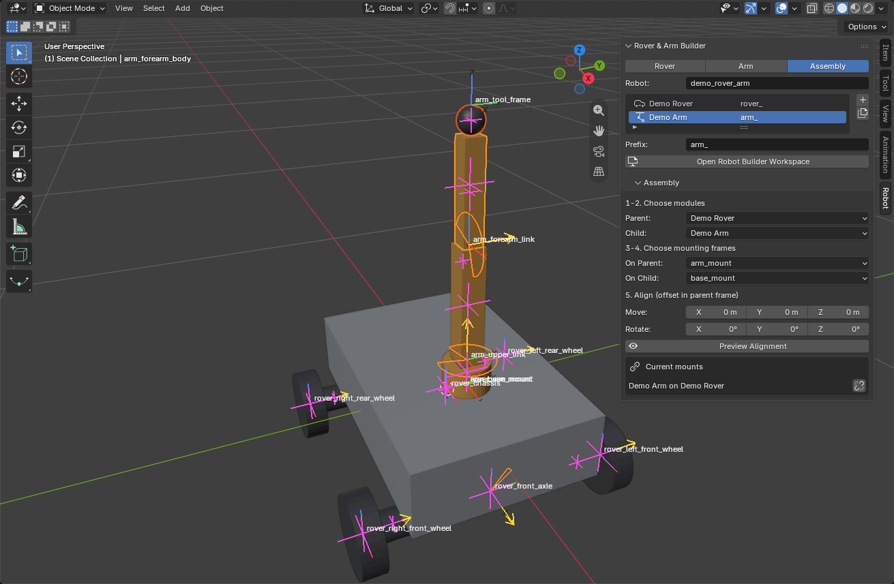
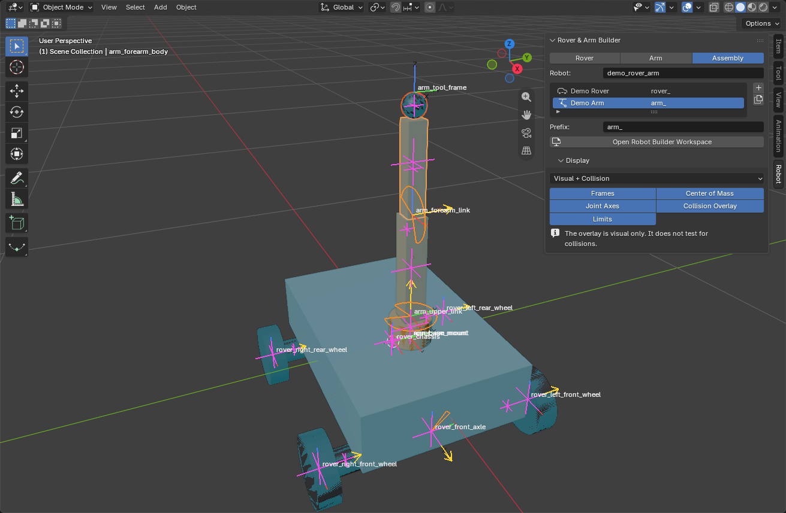
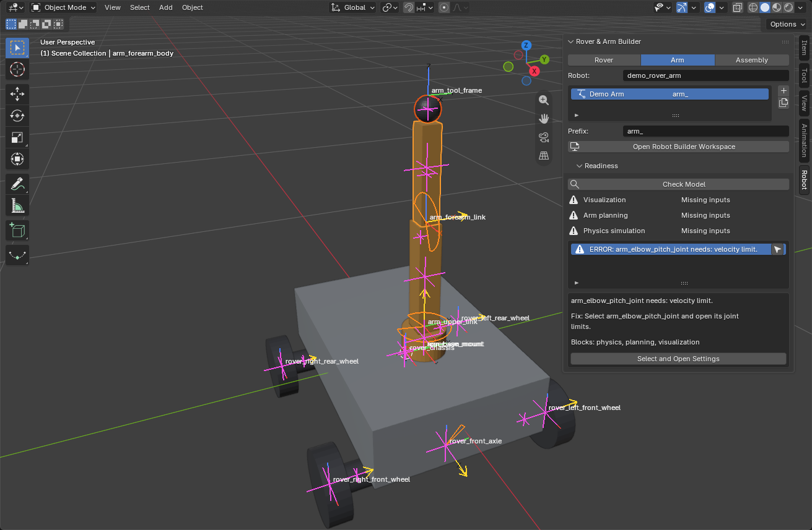
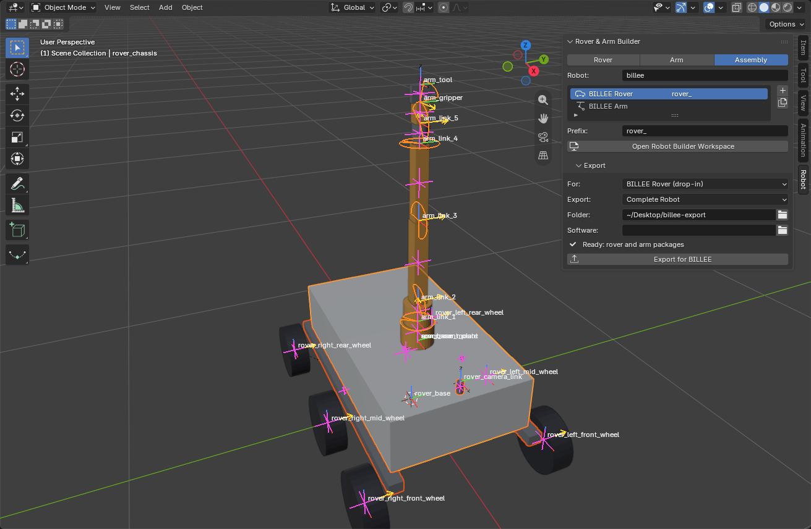
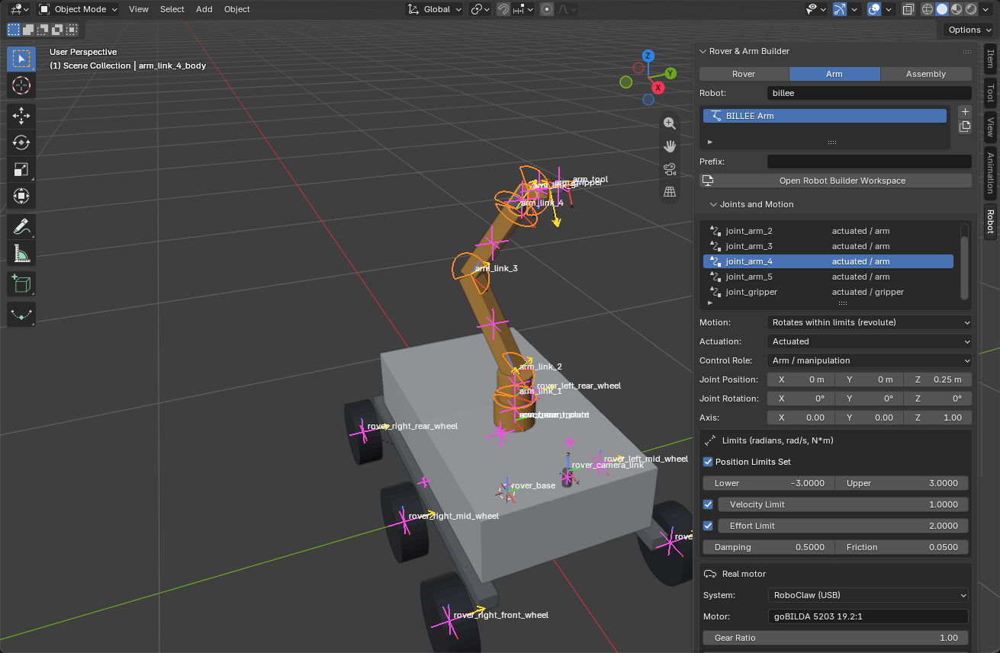

# BILLEE Creation Toolkit

Build a 1:1 model of a rover and arm **inside Blender**, define how every part moves, estimate its mass, and export a
ROS 2 package that runs on the BILLEE software stack.


- **Modular by design:** build the **Rover** and **Arm** separately, then join them in **Assembly**.
- **Rover export:** a drop-in `robot_description` for `billee-software-2027`, with no changes to that repo.
- **Arm export:** a complete MoveIt 2 package for planning and control.
- **Real engineering data:** joints, limits, frames, motors, mass, center of mass, inertia, and collision shapes.
- **Works offline:** you do not need ROS installed to design or export a robot.

## Contents

- [Install](#install)
- [Build your first robot](#build-your-first-robot)
- [Replace the BILLEE robot model](#replace-the-billee-robot-model)
- [Use the arm with MoveIt 2](#use-the-arm-with-moveit-2)
- [Standalone ROS 2 packages](#standalone-ros-2-packages)
- [What has been tested](#what-has-been-tested)
- [Development](#development)

## Install

You need [Blender 5.3 or newer](https://www.blender.org/download/) on Linux x64, Windows, or an Apple Silicon Mac.

**[Download the installer](https://github.com/LucaLanzi/BILLEE-creation-toolkit/releases/latest/download/BILLEE-Creation-Toolkit-0.1.0-Installer.zip)**,
unzip it, and run the file for your system:

| System | What to do | If it is blocked |
|---|---|---|
| **Windows** | Double-click `Install-Windows.bat` | Choose **More info**, then **Run anyway** |
| **macOS** | Double-click `Install-macOS.command` | **System Settings > Privacy & Security > Open Anyway** |
| **Linux** | Run `sh Install-Linux.sh` | |

The installer finds Blender, checks its version, installs and enables the extension, and confirms it worked.

**Prefer no script?** Drag `rover_arm_builder-0.1.0.zip` from the unzipped folder into an open Blender window.

**Already have this repo?** On Linux or macOS, run:

```sh
make install
```

### Open the toolkit

In Blender, hover over the 3D Viewport, press **N**, and click the **Robot** tab on the right edge.

<details>
<summary><b>Update, uninstall, and troubleshooting</b></summary>

To update, run the newer installer. To uninstall, run one of these in the unzipped folder:

```sh
Install-Windows.bat uninstall          # Windows
sh Install-macOS.command --uninstall   # macOS
sh Install-Linux.sh --uninstall        # Linux
```

| Problem | Fix |
|---|---|
| Blender is not found | Point to it: `BLENDER=/path/to/blender sh Install-Linux.sh`. On Windows, run `set "BLENDER=C:\path\to\blender.exe"` first |
| "5.3 or newer is required" | Install a current Blender. Older versions can stay installed |
| Several Blender versions | The installer uses the newest. Set `BLENDER` to choose another |
| The Robot tab is missing | Enable **Rover & Arm Builder** in **Edit > Preferences > Add-ons** |

</details>

## Build your first robot

Press **Create BILLEE Rover** for BILLEE's six-wheel layout, **Create BILLEE Rover + Arm** for both modules already
mounted, or **Create Demo Robot** to look around with a small example. Shapes, masses, and limits are placeholders, so
replace them with measured values.

### 1. Create the rover and its links

Open the **Rover** tab and press **+** beside the module list. A **link** is one rigid body. In **Links**, select a
parent and press **+** to attach a child, then choose how it moves. The list is indented to show the robot's structure.


### 2. Add parts and mass

In **Components and Mass**, press **+** and pick a part type such as Chassis, Wheel, or Motor Housing. Type dimensions
in any unit, for example `100mm`. Then choose where the mass comes from: measured, estimated, density, or manual.

> Put each motor housing on the link that **carries** it, not on the wheel, so the housing does not spin with the wheel.


### 3. Define joints and preview motion

Open **Joints and Motion** to set the axis, limits, and whether a joint is actuated or passive. Drag **Preview** to see
it move, save poses like `home` and `stow`, then press **Return to Zero**. Preview never changes your exported robot.


### 4. Add mounting and tool frames

In **Frames**, add a `mount` frame on the rover and on the arm, plus a `tool` frame at the arm's tip. Snap a frame to the
3D cursor, an object's origin, or its center, or type its exact position.


### 5. Mount the arm on the rover

Open the **Assembly** tab and choose both modules and both frames. Press **Preview Alignment**, adjust the offset if
needed, then press **Confirm Mount**. You can detach and remount at any time.



### 6. Inspect collision and mass

**Display** switches between visual and collision views and toggles the frame, axis, limit, and center-of-mass guides.
**Mass Summary** adds up the rover, arm, and full assembly.




> The collision overlay is a visual aid and does not test for collisions. A center-of-mass marker does not prove
> the robot will not tip.

### 7. Check the model

Press **Check Model** in **Readiness**. Each problem says what is wrong and how to fix it. Press **Select and Open
Settings** to jump straight to the affected part.



Once the problems are fixed, all three targets show as ready to export:


### 8. Export

To update the rover software, follow [Replace the BILLEE robot model](#replace-the-billee-robot-model). For any other
ROS 2 project, set **For** to **Generic ROS 2 Package**, choose the complete robot or one module, and press
**Export ROS 2 Package**.


### Handy tips

- Number fields accept math. Joint limits are in radians, so `radians(45)` works, and `250/1000` enters 250 g as kg.
- To move a link **with** its geometry, move its frame object. To move **only** the frame, use **To Cursor**,
  **To Origin**, or **To Center** in the Links panel.
- Moving the whole robot in Blender does not change the export.

## Replace the BILLEE robot model

The toolkit generates a complete `robot_description` folder for
[`billee-software-2027`](https://github.com/BILLEE-BroncoSTAR/billee-software-2027). No launch files, configs, or code
in that repo need to change.



1. **Build the rover** with six driven wheels, three on each side. Use X forward, Y left, and Z up.
2. **Press Check Model.** Under **Export**, wait for a **Ready** message.
3. **Export.** Set **For** to **BILLEE Rover (drop-in)**, choose a folder *outside* the software repo, and press
   **Export for BILLEE**. Set **Export** to **Active Module Only** if you want just the selected rover or arm.
4. **Drag and drop.** Drag the new `robot_description` folder onto `billee-software-2027/ros2_ws/src/` and choose
   **Replace** or **Merge**. Either works.
5. **Rebuild** from the software repo's dev container:

   ```sh
   cd ros2_ws
   pixi run build --packages-select robot_description
   ```

6. **Launch as usual** from the BILLEE dashboard or with `ros2 launch chassis_bringup rover.launch.py`.

To go back to the committed model, run this from the root of `billee-software-2027`:

```sh
git restore ros2_ws/src/robot_description && git clean -fd ros2_ws/src/robot_description
```

### What the toolkit handles for you

| The rover software expects | What the export does |
|---|---|
| Joints `joint_wheel_l1` to `r3` | Assigns your wheels by physical position, whatever you named them |
| `base_footprint` and `base_link` | Creates them, with `base_link` at the turning center |
| Wheel radius and track width | Measures them from your model and updates `controllers.yaml` |
| ODESC CAN IDs and hardware settings | Copies them unchanged from your software repo |
| Gazebo sensors, IMU, odometry, and control | Keeps them unchanged |
| ZED camera mount | Uses a frame named `camera_link` if you add one, or keeps the current pose |

If `~/billee-software-2027` exists, the export reads its current wiring and never writes to it. Otherwise, set the
**Software** folder or use the bundled copy from commit `e18b1f7`.

> **Suspension joints export as fixed**, because the rover software has no controller for them and its current model
> also uses a fixed suspension. The toolkit warns you about each joint it freezes. **Arm joints stay movable.**

The export also writes `robot_description_export.md` beside the folder, listing how each wheel and arm joint was mapped.

## Use the arm with MoveIt 2

The arm is its own module with its own package. An assembled export keeps the rover's drivetrain wiring identical and
adds `billee_arm_moveit_config` beside `robot_description`.


| You export | You get |
|---|---|
| **Rover** (Active Module Only) | `robot_description` for the existing rover software |
| **Arm** (Active Module Only) | A standalone MoveIt package with its own model and mock hardware |
| **Complete Robot** | Both, with MoveIt planning around the full rover |

### Set up each arm joint

Select a joint in **Joints and Motion**, set its **Control Role** to **Arm / manipulation** or **End effector**, and fill
in **Real motor**. Simulation works before these IDs are known.



| Axis | Motor | System | You provide |
|---|---|---|---|
| 1, 2, 3 | P20 or P17 | CAN (`pxx`) | CAN node ID, gear ratio |
| 4, 5, end effector | goBILDA 5203 19.2:1 | RoboClaw 2x7A over USB | Address, M1 or M2, encoder counts |

### Run it in simulation

MoveIt is not part of the software repo's environment, so the toolkit adds it as a separate layer. Run this once:

```sh
make moveit-env   # Multi-GB download. Does not change billee-software-2027
```

Start the rover from its dev container or dashboard in simulation. Then, in another terminal:

```sh
bash scripts/moveit_shell.sh ~/Desktop/billee-export
ros2 launch billee_arm_moveit_config moveit.launch.py
```

This starts `move_group`, adds the arm controllers to the running rover, and plans with the chassis in the collision
model. Planning groups are `arm` and `gripper`, with named poses `home`, `stow`, `open`, and `closed`. A five-axis arm
can't reach every position and orientation, so tool goals are position-only.

> **Real arm motors are not enabled yet.** The CAN axes work with the `pxx` driver in mock mode. The pinned RoboClaw
> driver reports position only, while the Humble trajectory controller needs a velocity state for velocity commands.
> The export report lists everything still open.

## Standalone ROS 2 packages

**Generic ROS 2 Package** makes a separate package for **ROS 2 Humble, Gazebo Fortress, and `ign_ros2_control`**:

```sh
cp -r my_robot_description ros2_ws/src/
cd ros2_ws
pixi shell
colcon build --packages-select my_robot_description
source install/setup.bash

ros2 launch my_robot_description display.launch.py   # RViz with joint sliders
ros2 launch my_robot_description gazebo.launch.py    # Gazebo with controllers
```

Keep your own files in `config/user/`. If you edit a generated file, the next export stops and names it instead of
overwriting it.

## What has been tested

| Area | Status |
|---|---|
| Blender 5.3.0 interface, undo, save and reload, install and uninstall on Linux | **Tested** |
| Real `xacro`, URDF parser, and TF on ROS 2 Humble | **Tested** |
| Gazebo Fortress: spawn, settle, arm control, wheel drive | **Tested** |
| Drop-in `robot_description` with the unmodified BILLEE launch files in simulation | **Tested** |
| MoveIt 2.5.9 on the BILLEE stack in Gazebo: plan, execute, gripper, IK, chassis collision rejection | **Tested** |
| Standalone arm with mock hardware | **Tested** |
| CAN arm axes with the real `pxx` driver in mock mode | **Tested** |
| Real arm motors | **Not enabled.** RoboClaw axes need a driver change first |
| Drop-in model on the real ODESC drivetrain | **Not tested.** The CAN wiring is copied unchanged |
| Windows and macOS installers | **Not yet run on those systems** |
| RViz window | **Not yet opened** |

Details are in [docs/TESTING.md](docs/TESTING.md) and known limits are in [docs/LIMITATIONS.md](docs/LIMITATIONS.md).

## Development

Requires Python 3.11+ and Blender 5.3+, with no other dependencies.

```sh
make test     # Fast unit tests, no Blender needed
make check    # Every local check, in an isolated Blender profile
make gui      # Also opens a real Blender window
make ros      # Real ROS 2 Humble and Gazebo checks, using the billee-software-2027 container
make dropin   # Run the generated robot_description through the unmodified BILLEE launch files
make moveit   # Plan and execute the arm with MoveIt on the unmodified rover stack
make bundle   # Build the installer ZIP for all platforms
make docs     # Recapture the screenshots in this README
```

On Windows, run the same scripts directly, for example `py scripts\check.py`.

See [Architecture](docs/ARCHITECTURE.md) and [Compatibility](docs/COMPATIBILITY.md).

## License

GPL-3.0-or-later. See [LICENSE](LICENSE).
