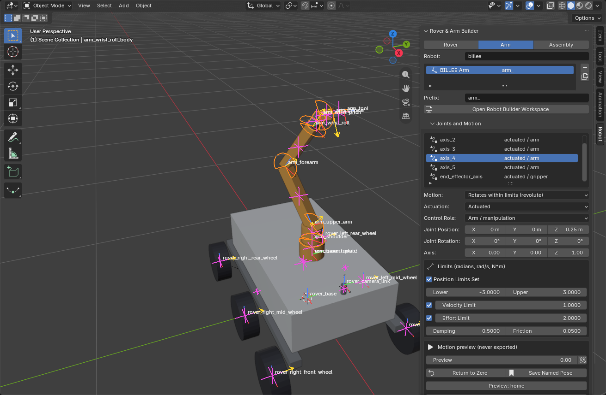
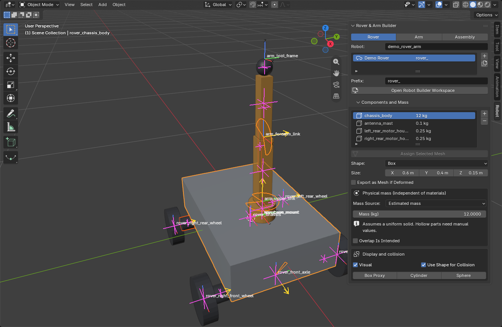
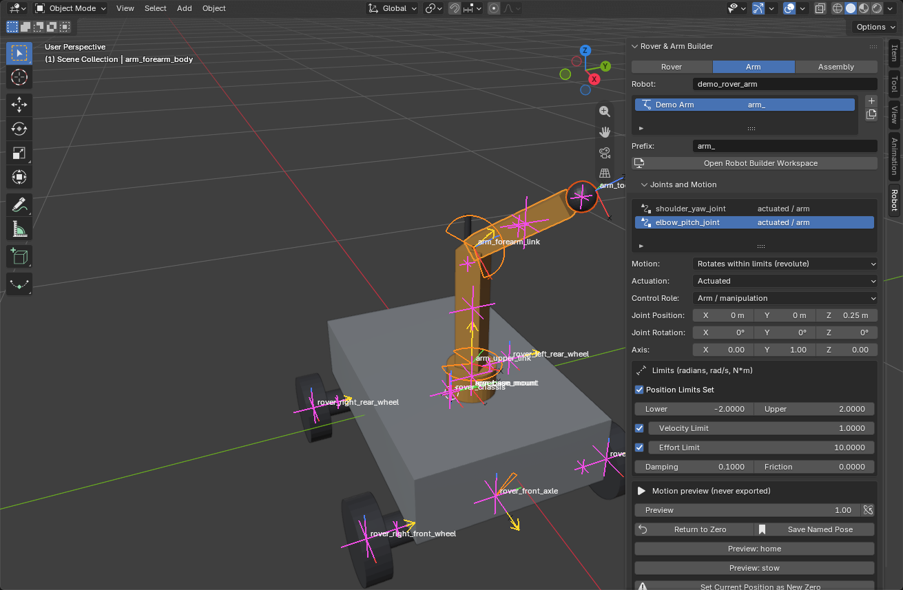
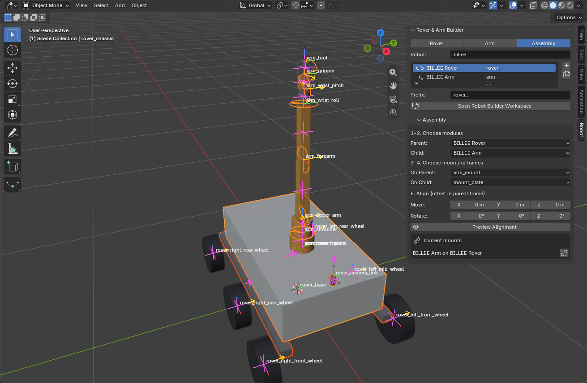

# BILLEE Creation Toolkit

Build the BILLEE rover and arm **inside Blender**, then export packages that drop into
[`billee-software-2027`](https://github.com/BILLEE-BroncoSTAR/billee-software-2027) with no changes to that repo.



| Tab | You build | You get |
|---|---|---|
| **Rover** | Chassis, six wheels, camera mount | `robot_description` |
| **Arm** | Five axes, end effector, tool frame | `arm_description` and a MoveIt 2 package |
| **Assembly** | The mount between them | All three, with MoveIt planning around the full rover |

## Install

You need [Blender 5.3 or newer](https://www.blender.org/download/) on Linux x64, Windows, or an Apple Silicon Mac.

**[Download the installer](https://github.com/LucaLanzi/BILLEE-creation-toolkit/releases/latest/download/BILLEE-Creation-Toolkit-0.2.0-Installer.zip)**,
unzip it, and run the file for your system:

| System | Run | If it is blocked |
|---|---|---|
| **Windows** | `Install-Windows.bat` | **More info > Run anyway** |
| **macOS** | `Install-macOS.command` | **System Settings > Privacy & Security > Open Anyway** |
| **Linux** | `sh Install-Linux.sh` | |

You can also drag `rover_arm_builder-0.2.0.zip` into an open Blender window, or run `make install` from this repo.

In Blender, hover over the 3D Viewport, press **N**, and click the **Robot** tab.

<details>
<summary><b>Update, uninstall, and troubleshooting</b></summary>

To update, run the newer installer. To uninstall, pass `uninstall` on Windows or `--uninstall` on macOS and Linux.

| Problem | Fix |
|---|---|
| Blender is not found | Run `BLENDER=/path/to/blender sh Install-Linux.sh`. On Windows, first run `set "BLENDER=C:\path\to\blender.exe"` |
| "5.3 or newer is required" | Install a current Blender. Older versions can stay installed |
| The Robot tab is missing | Enable **Rover & Arm Builder** in **Edit > Preferences > Add-ons** |

</details>

## Build the robot

Press **Create BILLEE Rover + Arm** to start from BILLEE's layout. Its shapes and masses are placeholders.

### 1. Rover

In the **Rover** tab, a **link** is one rigid body. Add links, then add parts with dimensions and mass. Use X forward,
Y left, and Z up. The rover needs six driven wheels, three on each side. Wheels are mapped by position, so their names
don't matter. Add a frame named `camera_link` where the ZED is mounted.




### 2. Arm

In the **Arm** tab, set five joints to **Arm / manipulation** and one to **End effector**, then add a **Tool** frame.
Joints are mapped to `joint_arm_1` through `joint_arm_5` by their order from base to tool. Motors and IDs stay in the
software repo's `arm_axes.yaml`. Use **Preview** to test motion. It never changes the export.




### 3. Assembly

In the **Assembly** tab, choose the rover and arm and a mounting frame on each. Press **Preview Alignment**, adjust the
offset if needed, then press **Confirm Mount**.



**Display** shows the collision shapes. This is a visual aid. MoveIt does the real collision checking.


### 4. Check and export

Press **Check Model**. Each issue explains the fix, and **Select and Open Settings** jumps to the part.


Under **Export**, keep **BILLEE Rover (drop-in)**, choose a folder *outside* the software repo, and press
**Export for BILLEE**. Set **Export** to **Active Module Only** to export just the selected rover or arm.


## Use it on BILLEE

Drag `robot_description` and `arm_description` onto `billee-software-2027/ros2_ws/src/`, choose **Replace**, and rebuild:

```sh
cd ros2_ws
pixi run build --packages-select robot_description arm_description
```

Launch from the dashboard as usual. To undo, run this from the root of `billee-software-2027`:

```sh
git restore ros2_ws/src/robot_description ros2_ws/src/arm_description
git clean -fd ros2_ws/src/robot_description ros2_ws/src/arm_description
```

### Plan with MoveIt 2

MoveIt isn't in the software repo's environment, so this repo runs it from a private copy of the stack:

```sh
make stack                                             # Once. Multi-GB download
bash scripts/billee_shell.sh ~/Desktop/billee-export   # Opens a ROS shell with your export
```

Start **Teleop · Arm** in the dashboard with **Arm** set to **Mock**. Then, in that shell:

```sh
ros2 launch billee_arm_moveit_config moveit.launch.py allow_unverified:=true
```

Plan with groups `arm` and `gripper` and poses `home`, `stow`, `open`, and `closed`. A five-axis arm can't reach every
orientation, so tool goals are position-only.

> **Real motors:** MoveIt refuses to move any axis marked `verified: false` in `arm_axes.yaml`. Use
> `allow_unverified:=true` only with mock hardware. Real-motor control is untested, so read
> [the limitations](docs/LIMITATIONS.md) first and keep the E-stop within reach.

## Development

Requires Python 3.11+ and Blender 5.3+.

```sh
make test     # Unit tests, no Blender needed
make gui      # All Blender checks, including a real window
make stack    # Build the private BILLEE stack
make billee   # Test exports with the dashboard's commands on that stack
make bundle   # Build the installer
make docs     # Recapture these screenshots
```

See [Testing](docs/TESTING.md) and [Limitations](docs/LIMITATIONS.md). Licensed under GPL-3.0-or-later.
